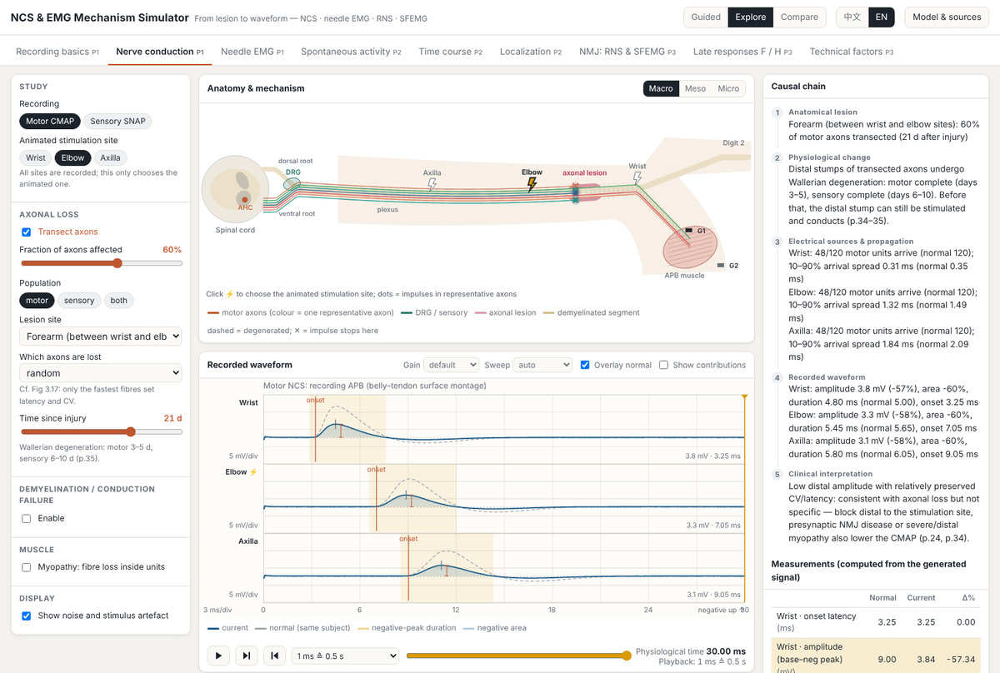
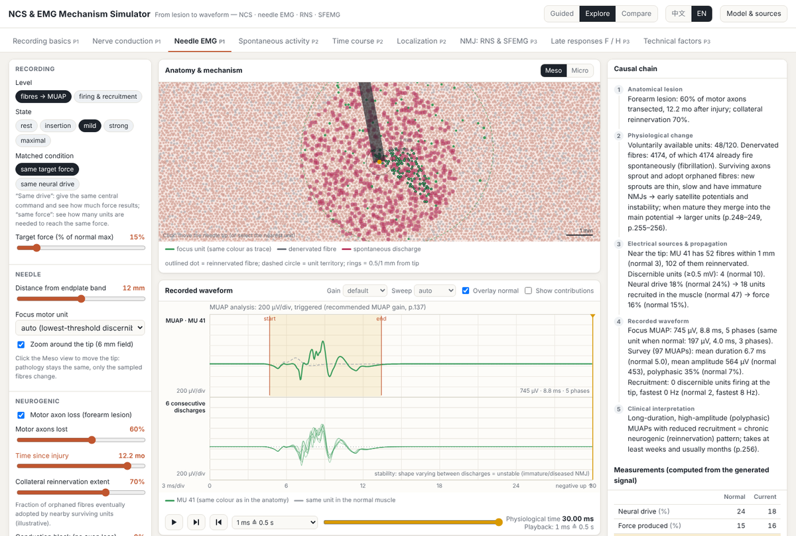
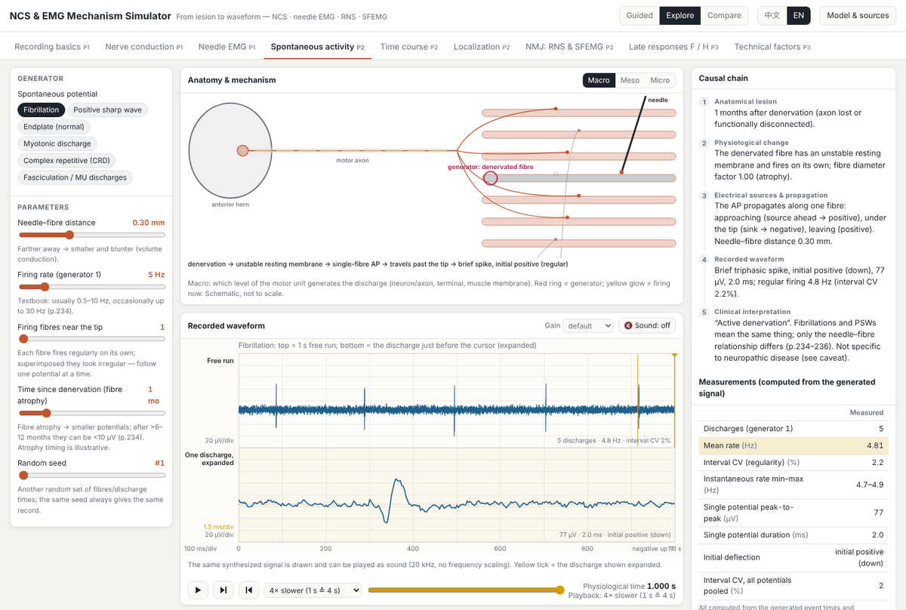
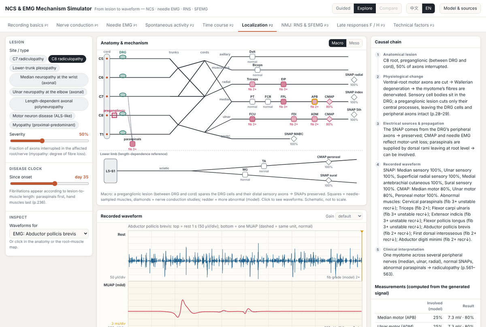

# NCS & EMG Mechanism Simulator · 神经传导与肌电图机制模拟器

An interactive teaching application that shows **why** nerve conduction and needle EMG
waveforms look the way they do:

> anatomical lesion → physiological change → altered electrical sources and propagation →
> recorded waveform → clinical interpretation

Waveforms are **generated** from individual sources — each axon's conduction, each muscle
fibre's action potential at its distance from the electrode — and are never switched between
pre-drawn pictures. Every number on screen is measured from the generated signal by the same
conventions a reader would use. Chinese explanations with English technical terms are the
default; an English interface is available (top right).

Primary reference: Preston DC, Shapiro BE. *Electromyography and Neuromuscular Disorders:
Clinical–Electrophysiologic–Ultrasound Correlations*, 4th ed. Elsevier, 2020. Citations use
**printed** page numbers.



## Quick start

**Just run it:** download [`dist/index.html`](dist/index.html) and double-click it. It is a
single self-contained file (~630 KB) that works offline from `file://` in Chrome, Edge,
Firefox or Safari. No installation, no build step, no network access.

**Work on the source** (Node.js ≥ 18, no npm packages required):

```bash
node tools/serve.mjs          # http://localhost:8080/ (bundle) or /src/index.html (modules)
node tools/build.mjs          # rebuild dist/index.html after editing src/
node --test tests/*.test.mjs  # 41 causal validation tests
```

## What it does

| | |
|---|---|
| **Modes** | *Guided* — 7 lessons that change one variable per step; *Explore* — all controls; *Compare* — 2–3 mechanisms side by side on the same simulated subject and seed. |
| **Panels** | Left: controls for the current module. Centre: the anatomy/mechanism view (Macro / Meso / Micro) above the waveform (negative up). Right: the causal chain, measurements against normal, an interpretation caveat, and **“Why did this change?”** |
| **Two clocks** | The transport bar plays the *physiological* event in milliseconds, in slow motion, with the playback speed shown separately (“1 ms ≙ 0.5 s”). Disease time — days to years — is a separate control. |
| **Provenance** | **Model & sources** lists every parameter as *textbook* (with the page), *derived*, *literature* or *illustrative*. Anything labelled illustrative is a teaching knob, **not** a clinical criterion. |

### Modules

| Module | Content |
|---|---|
| Recording basics 记录原理 | Volume conduction, moving the electrode, summation and phase cancellation |
| Nerve conduction NCS | CMAP/SNAP, distal vs proximal stimulation, axonal loss (hyperacute/Wallerian, preganglionic), demyelination (slowing / dispersion / block / nodal failure), myopathy |
| Needle EMG 针极肌电图 | Fibres → MUAP → firing → recruitment; rest, insertion, mild and strong contraction; neurogenic acute→chronic with reinnervation; conduction block; myopathy; central activation; matched force vs matched drive |
| Spontaneous activity 自发电位实验室 | Fibrillation, positive sharp wave (crushed-zone model), endplate noise and spikes, myotonic discharge, CRD (ephaptic loop), fasciculation / doublet / myokymic; firing-pattern measures; optional loudspeaker audio, muted by default and with no frequency scaling |
| Time course 病程与时间 | A disease clock from 12 hours to 2 years, separate from the millisecond clock; partial, complete (with regrowth) and demyelinating block; NCS, rest EMG and MUAPs at every point |
| Localization 定位诊断 | C7/C8 radiculopathy (preganglionic, DRG drawn), lower-trunk plexopathy, median at the wrist, ulnar at the elbow, length-dependent polyneuropathy, MND, myopathy; root–muscle map (Table 32.6) and SNAP–plexus map (Table 33.2); every nerve and muscle simulated separately |
| NMJ: RNS & SFEMG | Slow and rapid RNS, brief exercise, postexercise exhaustion; normal, myasthenia gravis, LEMS, botulism, immature endplates; EPP against threshold per safety class; SFEMG jitter (MCD) and blocking |
| Late responses F / H | F waves (backfiring, persistence, chronodispersion, F estimate, proximal vs distal stimulation, proximal demyelination); H reflex (Ia threshold, recruitment curve, collision) |
| Technical factors 技术因素 | Temperature, submaximal stimulation, G1 off the motor point, filters, and display sensitivity vs the latency you read — with the patient normal throughout |

<p align="center">
  
  
</p>
<p align="center">
  
</p>

## How it works

The simulator is a transparent generative model, not a library of stored traces:

* **Volume conduction** — each fibre action potential has a fixed spatial profile; membrane
  current is its second spatial derivative, and the extracellular potential is the sum of those
  currents weighted by distance. Triphasic potentials, initial negativity under the electrode,
  amplitude falling with distance and phase cancellation all *emerge* rather than being drawn.
* **Nerve** — 120 motor and 600 sensory axons, each with its own conduction velocity, conducted
  segment by segment along a median-like limb. Lesions act on individual axons.
* **Muscle** — ≈23,000 fibres in 120 intermingled motor units, with their own endplate
  positions, diameters and terminal delays. The same pool produces the surface CMAP and the
  needle MUAPs.
* **Activation** — neural drive, firing rate, recruited units and force are kept as separate
  quantities, so "early recruitment" can be shown as a statement about force, not about drive.

Full detail, including every illustrative constant and every known deviation, is in
[`docs/MODEL_ASSUMPTIONS.md`](docs/MODEL_ASSUMPTIONS.md),
[`docs/SOURCE_MAP.md`](docs/SOURCE_MAP.md) and
[`docs/KNOWN_ISSUES.md`](docs/KNOWN_ISSUES.md).

## Validation

`node --test tests/*.test.mjs` runs 41 tests that check *causal direction*, not clinical
reference values — for example that collateral reinnervation enlarges surviving units without
restoring their number, that a preganglionic lesion spares the SNAP, that slow RNS in
myasthenia gives a U-shaped decrement, and that display sensitivity changes the onset latency
you read while leaving the peak latency alone.

## Project structure

```
src/core/        seeded rng, parameter provenance registry, utilities
src/physiology/  nerve (axons, lesions, conduction), muscle (fibres, motor units),
                 lesions (denervation, reinnervation, myopathy), recruitment, subject,
                 spontaneous (firing processes), nmj, late, localize (root–nerve–muscle map)
src/synthesis/   volume (line-source model), ncs (CMAP/SNAP), emg (MUAPs, signals),
                 measure, filters
src/render/      theme, scope (oscilloscope), macro / meso / micro views, generator, plexus
src/content/     i18n and the explanatory text for each module, lessons
src/ui/          app host, controls, transport, audio, modules/*
tests/           causal validation tests (node --test)
tools/           build.mjs (single-file bundler), serve.mjs, screenshot and demo recorders
docs/            MODEL_ASSUMPTIONS.md, SOURCE_MAP.md, SOURCE_NOTES.md,
                 KNOWN_ISSUES.md, CHECKPOINT.md
```

## Disclaimer

This is a **teaching model**, not a diagnostic tool and not a laboratory reference. Values
labelled *illustrative* are chosen to make a mechanism visible and are not thresholds; the
"normal" column throughout is the same simulated subject, not a reference range. Clinical
decisions must rest on real recordings interpreted in context.

All illustrations are original schematics drawn by code; no figure from the textbook is
reproduced.
