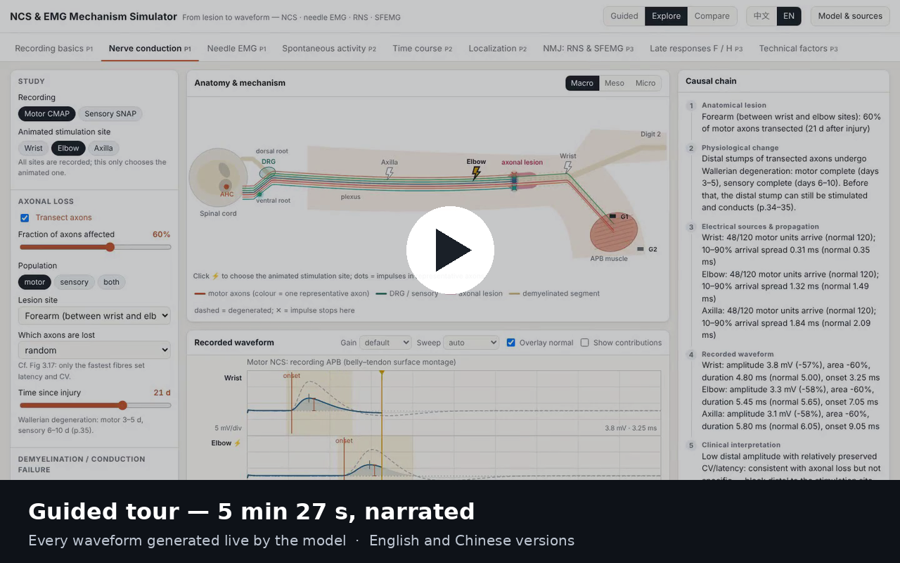

# NCS & EMG Mechanism Simulator · 神经传导与肌电图机制模拟器

**Why does this waveform look like this?** Most EMG teaching material answers with a picture of
the answer. This answers with the mechanism — and then generates the waveform in front of you,
from the individual sources that produce it.

> anatomical lesion → physiological change → altered electrical sources and propagation →
> recorded waveform → clinical interpretation

Every trace is computed from each axon's conduction and each muscle fibre's action potential at
its own distance from the electrode. Nothing is switched between stored pictures, and every
number on screen is measured from the generated signal using the conventions a reader would
apply. Change the fraction of axons lost and the amplitude falls because fewer sources are
contributing — not because a parameter was tied to a curve.

## Watch the tour

[](demo/demo-en.mp4)

<video src="https://github.com/zhenyuanzhou/NCS-EMG-Mechanism-Simulator/raw/main/demo/demo-en.mp4" controls width="100%"></video>

**▶ [English narration](demo/demo-en.mp4)**  ·  **▶ [中文解说](demo/demo-zh.mp4)** — 5 min 34 s

The tour runs the real application: normal conduction, axonal loss, conduction block and
temporal dispersion, needle EMG from fibres to recruitment, myopathy, chronic reinnervation,
spontaneous activity, the time course of a lesion from 12 hours to a year, localization from
root to plexus to nerve, repetitive stimulation in myasthenia, and F waves. *(If the player
above doesn't appear, the links work — GitHub renders inline video only in some views.)*

## Try it in 10 seconds

Download **[`dist/index.html`](dist/index.html)** and double-click it.

One self-contained file, ~630 KB. No install, no build, no network, no telemetry. It runs
offline from `file://` in Chrome, Edge, Firefox or Safari — which also means you can put it on a
USB stick and teach from a machine that has nothing installed.

Working on the source needs Node.js ≥ 18 and **no npm packages at all**:

```bash
node tools/serve.mjs          # http://localhost:8080/ (bundle) or /src/index.html (modules)
node tools/build.mjs          # rebuild dist/index.html after editing src/
node --test tests/*.test.mjs  # 41 causal validation tests
```

## What you can do with it


Three panels stay in step: the **mechanism** (macro anatomy → motor-unit territory → single
fibre and electrode), the **waveform** it produces, and the **reasoning** — a five-step causal
chain, measurements against the same simulated subject when normal, and an interpretation
caveat drawn from the textbook.

| | |
|---|---|
| **Three modes** | *Guided* — 7 lessons that change exactly one variable per step. *Explore* — every control. *Compare* — 2–3 mechanisms side by side on the same subject and seed, so only the pathology differs. |
| **Two clocks, never confused** | The transport bar plays the *physiological* event in milliseconds, in slow motion, with playback speed stated separately ("1 ms ≙ 0.5 s"). Disease time — hours to years — is a different control entirely. Conflating these two is a common source of confusion; here they can't be. |
| **"Why did this change?"** | After any change, the app explains which mechanism moved and what it did to the signal — in terms of sources and propagation, not just a bigger or smaller number. |
| **Honest provenance** | **Model & sources** lists every parameter as *textbook* (with the printed page), *derived*, *literature* or *illustrative*. Anything illustrative is a teaching knob and is labelled as one, **never** presented as a clinical threshold. |

### Modules

| Module | What it shows |
|---|---|
| **Recording basics** 记录原理 | Volume conduction; move the electrode and watch triphasic, initially-negative and purely positive potentials arise from geometry alone; summation and phase cancellation |
| **Nerve conduction** NCS | CMAP and SNAP, distal vs proximal stimulation, axonal loss (including hyperacute pseudo-block and Wallerian timing, and preganglionic lesions), demyelination split into independent slowing / dispersion / block / nodal failure, myopathy |
| **Needle EMG** 针极肌电图 | Fibres → MUAP → firing → recruitment and interference; rest, insertion, mild and strong contraction; neurogenic from acute to chronic with collateral reinnervation; conduction block; myopathy; reduced central activation; matched force vs matched drive |
| **Spontaneous activity** 自发电位实验室 | Fibrillation, positive sharp wave (modelled as a needle-deformed inexcitable zone), endplate noise and spikes, myotonic discharge, complex repetitive discharge as an ephaptic loop, fasciculation / doublet / myokymic bursts — with firing-pattern measures, because morphology alone cannot identify a generator. Optional loudspeaker audio, muted by default, played at the true sample rate with no frequency scaling |
| **Time course** 病程与时间 | One lesion from 12 hours to 2 years: partial, complete (with regrowth) and demyelinating block, with NCS, rest EMG and MUAPs recomputed at every point |
| **Localization** 定位诊断 | C7/C8 radiculopathy (preganglionic, DRG drawn), lower-trunk plexopathy, median at the wrist, ulnar at the elbow, length-dependent polyneuropathy, motor neuron disease, myopathy — read as a *pattern* across a root–muscle map (Table 32.6) and a SNAP–plexus map (Table 33.2), with every nerve and muscle simulated separately |
| **NMJ: RNS & SFEMG** | Slow and rapid repetitive stimulation, brief exercise, postexercise exhaustion; normal, myasthenia gravis, LEMS, botulism, immature endplates; endplate potential against threshold for each safety-factor class; single-fibre jitter (MCD) and blocking |
| **Late responses F / H** | F waves — backfiring, persistence, chronodispersion, the F estimate, proximal vs distal stimulation, proximal demyelination. H reflex — Ia threshold, the recruitment curve, and collision |
| **Technical factors** 技术因素 | Temperature, submaximal stimulation, G1 off the motor point, filters, and display sensitivity vs the onset latency you read — with the patient normal throughout, so you can see an artefact that looks exactly like disease |

<p align="center">
  
  
</p>
<p align="center">
  
</p>

## How the model works

* **Volume conduction.** Each fibre action potential has a fixed spatial profile; membrane
  current is its second spatial derivative; the extracellular potential is the sum of those
  currents weighted by distance (line-source, integrated exactly per cell). Triphasic
  potentials, initial negativity when depolarisation starts under the electrode, amplitude
  falling with distance and phase cancellation are all *emergent* — none of them is drawn.
* **Nerve.** 120 motor and 600 sensory axons, each with its own conduction velocity, conducted
  segment by segment along a median-like limb. Lesions act on individual axons, so a transected
  stump still conducts until it degenerates.
* **Muscle.** ≈23,000 fibres in 120 intermingled motor units with their own endplate positions,
  diameters and terminal delays. The *same* pool produces the surface CMAP and the needle MUAPs,
  which is why reinnervation partly restores CMAP amplitude: amplitude counts fibres, not axons.
* **Activation.** Neural drive, firing rate, number of recruited units and force are kept as
  four separate quantities — so "early recruitment" can be demonstrated as a statement about
  force, and shown to disappear when you match drive instead.

Every illustrative constant, every schematic simplification and every known deviation from the
textbook is written down:
[`docs/MODEL_ASSUMPTIONS.md`](docs/MODEL_ASSUMPTIONS.md) ·
[`docs/SOURCE_MAP.md`](docs/SOURCE_MAP.md) ·
[`docs/KNOWN_ISSUES.md`](docs/KNOWN_ISSUES.md)

## Validation

```bash
node --test tests/*.test.mjs     # 41 tests
```

The tests check **causal direction**, not clinical reference values — a teaching model should be
judged on whether it behaves for the right reasons. For example: collateral reinnervation
enlarges surviving units without restoring their number; a preganglionic lesion spares the SNAP
while denervating the myotome; slow repetitive stimulation in myasthenia produces a U-shaped
decrement that recovers as the mobilisation store resupplies; display sensitivity shifts the
onset latency you read while leaving the peak latency untouched.

## Project structure

```
src/core/        seeded rng, parameter provenance registry, utilities
src/physiology/  nerve (axons, lesions, conduction), muscle (fibres, motor units),
                 lesions (denervation, reinnervation, myopathy), recruitment, subject,
                 spontaneous (firing processes), nmj, late, localize (root–nerve–muscle map)
src/synthesis/   volume (line-source model), ncs (CMAP/SNAP), emg (MUAPs, signals),
                 measure (textbook measurement conventions), filters
src/render/      theme, scope (oscilloscope), macro / meso / micro views, generator, plexus
src/content/     i18n and the explanatory text for every module, guided lessons
src/ui/          app host, controls, transport, audio, modules/*
tests/           causal validation tests (node --test)
tools/           build.mjs (dependency-free single-file bundler), serve.mjs,
                 demo-dubbed.mjs + mux-dub.mjs (narrated demo recorder)
docs/            MODEL_ASSUMPTIONS.md, SOURCE_MAP.md, SOURCE_NOTES.md,
                 KNOWN_ISSUES.md, CHECKPOINT.md, narration script
demo/            the narrated tour, English and Chinese
```

## Reference

Preston DC, Shapiro BE. *Electromyography and Neuromuscular Disorders:
Clinical–Electrophysiologic–Ultrasound Correlations*, 4th ed. Elsevier, 2020. Citations
throughout the app and the docs use **printed** page numbers.

All illustrations are original schematics drawn by code. No figure from the textbook is
reproduced.

## Licence

[](https://creativecommons.org/licenses/by-nc/4.0/)

Released under [Creative Commons Attribution-NonCommercial 4.0 International](LICENSE)
(CC BY-NC 4.0). You may share and adapt it — including for teaching — provided you give
attribution and do not use it commercially. For commercial use, please ask.

## Disclaimer

This is a **teaching model** — not a diagnostic tool, and not a laboratory reference. Values
labelled *illustrative* were chosen to make a mechanism visible and are not thresholds. The
"normal" column throughout is the same simulated subject, not a reference range. Real clinical
interpretation depends on real recordings, a real patient, and reference values from the
laboratory that produced them.
